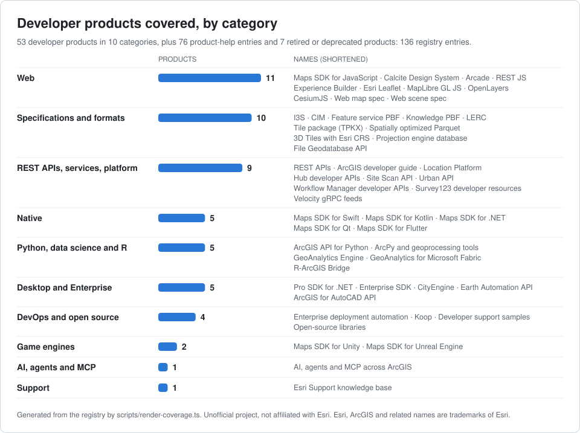
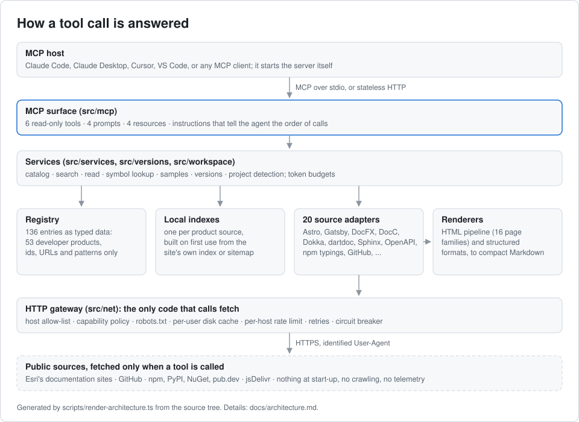
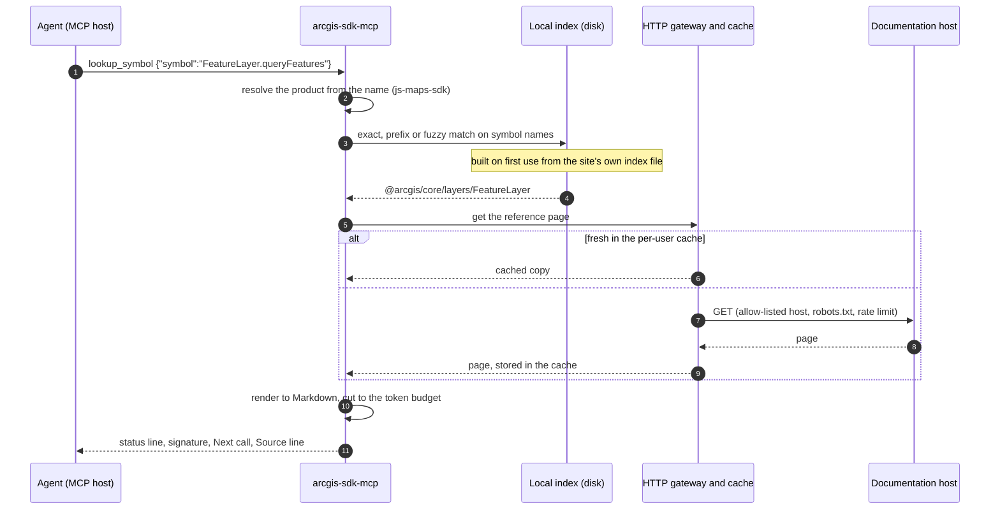

# arcgis-sdk-mcp

**An MCP server that lets coding agents look up Esri's ArcGIS developer documentation while
they work, instead of guessing from memory.**

[](https://github.com/aselimc/arcgis-sdk-mcp/actions/workflows/ci.yml)
[](LICENSE)
[](package.json)
[](https://modelcontextprotocol.io)

> **Unofficial. Not affiliated with, endorsed by or sponsored by Esri.** An independent,
> non-commercial, open-source project that reads Esri's public documentation on demand,
> caches it on your machine and credits the source on every answer. See
> [Source policy and legal note](#source-policy-and-legal-note).

<p align="center">
  
</p>

<sub>Real output of `node dist/cli/main.js call ...`, trimmed: Esri's prose is replaced by
`[...]`. The recording is [docs/assets/hero-terminal.txt](docs/assets/hero-terminal.txt);
[docs/demos.md](docs/demos.md) has more.</sub>

## What it does, in 30 seconds

**The problem.** ArcGIS APIs change with every release. The JavaScript SDK moved from 4.x
widgets to 5.x web components, and the native SDKs from 200.x to 300.x, so what a model
remembers is often a version behind, and it writes code against APIs that have moved.

**What this server does.** It gives the agent six read-only tools: list products, check
versions, search, read a page, look up a symbol, find samples. The agent asks for what it
needs; the server fetches that one page, index file or package file from the public source,
turns it into compact Markdown within a token budget, and answers with the product, the
version it describes and the source URL. It ships no documentation.

**What it covers.** The registry holds 136 entries: **53 developer products** in 10
categories, from the ArcGIS Maps SDKs for JavaScript, Swift, Kotlin, .NET, Qt, Flutter, Unity
and Unreal Engine to ArcPy, the ArcGIS API for Python, the REST APIs and the web map, CIM and
I3S specifications; 76 end-user product-help entries; and 7 retired or deprecated products
that point to their successors. Documentation is read through 20 source adapters, one per way
Esri publishes it.

<picture>
  <source media="(prefers-color-scheme: dark)" srcset="docs/assets/coverage-dark.svg">
  
</picture>

Every number above comes from the registry ([docs/products.md](docs/products.md) lists each
product with its version lines and sources); the chart is regenerated by
`scripts/render-coverage.ts`.

## Quick start

Requires Node.js 22.12 or later. There is no API key and no account.

> **Not on npm yet.** Version 0.1.0 has not been published. Until it is, do not run
> `npx -y arcgis-sdk-mcp`: npm would install whatever package someone else publishes under
> that name. Build it from a clone:

```sh
git clone https://github.com/aselimc/arcgis-sdk-mcp.git
cd arcgis-sdk-mcp
npm ci
npm run build
node dist/cli/main.js call list_products '{"category":"native"}'
```

Then add it to your MCP host, which starts the server itself. For Claude Code:

```sh
claude mcp add arcgis-docs -- node /absolute/path/to/arcgis-sdk-mcp/dist/cli/main.js
```

[examples/host-configs](examples/host-configs/) has ready-to-copy files for Claude Code,
Claude Desktop, Cursor and VS Code, and [Add it to your host](#add-it-to-your-host) below
has the details. Once it is added, ask your agent something version-sensitive, such as "add
clustering with popups to this map". The server's instructions tell the agent when to call
the tools and in which order.

## Examples

| Example                                                    | What it shows                                                                    |
| ---------------------------------------------------------- | -------------------------------------------------------------------------------- |
| [quickstart-client](examples/quickstart-client/)           | A TypeScript MCP client walks one agent task in five tool calls; real transcript |
| [agent-builds-a-map-app](examples/agent-builds-a-map-app/) | A script that has Claude build an ArcGIS Maps SDK for JavaScript app (not run)   |
| [host-configs](examples/host-configs/)                     | Server entries for Claude Code, Claude Desktop, Cursor and VS Code               |

After the build, `npx tsx examples/quickstart-client/quickstart.ts` runs the quickstart
against the live documentation sites. The agent example needs an Anthropic API key and has
not been run for this repository yet; its README says so, and the app next to it is labelled
as hand-written from tool output.

## Contents

- [The six tools](#the-six-tools)
- [A typical agent workflow](#a-typical-agent-workflow)
- [Add it to your host](#add-it-to-your-host)
- [Configuration](#configuration)
- [Command line](#command-line)
- [How it works](#how-it-works)
- [Hosting](#hosting)
- [Source policy and legal note](#source-policy-and-legal-note)
- [Development and testing](#development-and-testing)
- [Status and known limitations](#status-and-known-limitations)
- [Roadmap](#roadmap)
- [Licence](#licence)

## The six tools

All six are read-only. Full argument and result schemas are in [docs/tools.md](docs/tools.md),
and [docs/demos.md](docs/demos.md#the-six-tools-one-real-call-each) shows one real call of
each.

| Tool                        | What it does                                                                                |
| --------------------------- | ------------------------------------------------------------------------------------------- |
| `arcgis_docs_list_products` | Lists products, describes one, or returns the table of contents of one documentation source |
| `arcgis_docs_get_versions`  | Documented, installable and project versions, compatibility pairings, release-notes refs    |
| `arcgis_docs_search`        | Ranked hits over guides, API members, REST operations, samples and product help             |
| `arcgis_docs_read`          | One page, API reference page, sample, GitHub file or brief as clean Markdown                |
| `arcgis_docs_lookup_symbol` | Declaration and documentation of one class, method, component, REST operation or tool       |
| `arcgis_docs_find_samples`  | Runnable samples from Esri's sample pages and Apache-2.0 sample repositories                |

Every text result has the same shape: a status line (resolved product, version, kind, cache
state), the body, at most one `Next:` line holding a complete follow-up call, and, when the
content was fetched, a `Source:` line. `arcgis_docs_read` and `arcgis_docs_lookup_symbol`
return text only; the other four also return `structuredContent` that conforms to an output
schema.

- **Version aware.** It reports the version the documentation describes, the version a
  package manager installs and the version found in your project, and says when they differ.
- **Small answers.** Every result has a token budget. A long page comes back as its opening
  section and an outline with section sizes; one more call reads the section that is needed. A
  23,000-token REST reference page costs 1,500 tokens this way.
- **One kind of handle.** A document reference is its URL. The agent can pass back any Esri
  documentation URL it meets in code, in an error message or in a search result.
- **Clear about gaps.** "Not found" is reported as "not verified", a degraded answer says why,
  and a failed call says what went wrong and what to do next, in one line.

**Prompts and resources.** Four prompts script common jobs for hosts that show prompts:
`arcgis_app_kickoff` (plan a new app), `arcgis_upgrade_review` (review an SDK upgrade),
`arcgis_agentic_app_design` (design an app that uses Esri's AI components or MCP servers) and
`arcgis_project_instructions` (write `AGENTS.md`-style instructions for a project). Four
resources are available under `arcgis-docs://`: `catalog` (every product as JSON),
`product/{id}` (one profile), `brief/{slug}` (ten short briefs written by this project, also
readable as `brief:<slug>` through `arcgis_docs_read`) and `status` (the effective source
policy, the cache, detected SDKs and the health of each source; over HTTP it leaves out the
cache directory and the detected SDKs, which describe the host).

## A typical agent workflow

A user asks an agent to add clustering with popups to a web map. The project's
`package.json` lists `@arcgis/core`.

1. `arcgis_docs_get_versions({})` finds `@arcgis/core` in the project, reports the installed
   version next to the current one, and returns the refs of the release notes.
2. `arcgis_docs_lookup_symbol({"symbol":"FeatureLayer.featureReduction"})` returns the
   declaration and documentation of the property. No `product` is needed: one SDK was
   detected.
3. `arcgis_docs_search({"query":"cluster points with popups"})` finds the guide page, and
   `arcgis_docs_read({"ref":"<url>","section":"<id>"})` reads only the section the outline
   pointed to.
4. `arcgis_docs_find_samples({"query":"point clustering","uses_api":"FeatureLayer"})` returns
   a runnable sample; `arcgis_docs_read` with `section: "source"` returns its code.
5. The agent writes the change and cites the source URLs it relied on.

Most results end with a `Next:` line holding the most useful follow-up call, so the agent
rarely has to work out the next step itself.
[examples/quickstart-client/transcript.txt](examples/quickstart-client/transcript.txt) is a
real run of a similar sequence.

## Add it to your host

An MCP host starts the server itself. Until the npm release, point it at the build of a clone
with an absolute path, as in [Quick start](#quick-start). After the release the command
becomes `npx` with the arguments `-y arcgis-sdk-mcp`.

| Host           | Where the entry goes                                                | Copy-ready file                                                    |
| -------------- | ------------------------------------------------------------------- | ------------------------------------------------------------------ |
| Claude Code    | `claude mcp add ...`, or `.mcp.json` at the project root for a team | [claude-code.mcp.json](examples/host-configs/claude-code.mcp.json) |
| Claude Desktop | Settings, Developer, Edit Config (`claude_desktop_config.json`)     | [claude-desktop.json](examples/host-configs/claude-desktop.json)   |
| Cursor         | `.cursor/mcp.json` in the project, or `~/.cursor/mcp.json`          | [cursor.mcp.json](examples/host-configs/cursor.mcp.json)           |
| VS Code        | `.vscode/mcp.json` in the workspace (note the `servers` key)        | [vscode.mcp.json](examples/host-configs/vscode.mcp.json)           |

[.mcp.json.example](.mcp.json.example) has the `npx` form for after the release, in a POSIX
and a Windows variant.

- **Windows.** Some hosts on Windows cannot start the `npx` shim directly. Run it through
  `cmd`: `"command": "cmd", "args": ["/c", "npx", "-y", "arcgis-sdk-mcp"]`. With Claude Code:
  `claude mcp add arcgis-docs -- cmd /c npx -y arcgis-sdk-mcp`. The `node` form needs no
  wrapper.
- **Project detection.** The server looks for Esri SDKs in the directory it is started in, so
  that a bare symbol name or an unscoped search refers to the SDK your project uses. Hosts that
  start servers somewhere else (Claude Desktop, a global Cursor entry) can name the project
  with `"env": { "ARCGIS_DOCS_PROJECT_DIR": "/path/to/your/project" }`.
- **HTTP.** `node dist/cli/main.js --http --port 3333` serves stateless MCP at
  `http://127.0.0.1:3333/mcp`, with a health check at `/healthz`. It binds to loopback and
  validates the `Host` and `Origin` headers. With `ARCGIS_DOCS_HTTP_TOKEN` set, every `/mcp`
  request must carry it as a bearer token; any other `--host` needs `--allow-remote` and the
  token. Project detection and local package reads are off in HTTP mode. See
  [Hosting](#hosting).

## Configuration

Everything is set through environment variables, in the `env` object of the host's server
entry or in the shell. None is required.

| Variable                   | Default                  | Meaning                                                                                                                   |
| -------------------------- | ------------------------ | ------------------------------------------------------------------------------------------------------------------------- |
| `ARCGIS_DOCS_SOURCES`      | `standard`               | Source policy: a preset (`strict` or `standard`) and/or `+capability` / `-capability` items, comma separated              |
| `ARCGIS_DOCS_OFFLINE`      | off                      | `1` answers from the cache only; a document that is not cached fails with `OFFLINE_MISS`                                  |
| `ARCGIS_DOCS_CACHE_DIR`    | per-user cache directory | Where responses and indexes are stored                                                                                    |
| `ARCGIS_DOCS_CACHE_MAX_MB` | `500`                    | Size cap of the cache on disk                                                                                             |
| `ARCGIS_DOCS_PROJECT_DIR`  | working directory        | The project in which Esri SDK versions are detected                                                                       |
| `ARCGIS_DOCS_MAX_TOKENS`   | `6000`                   | Size of an `arcgis_docs_read` result when the call does not choose `max_tokens` (500 to 20000)                            |
| `ARCGIS_DOCS_LOG_LEVEL`    | `warn`                   | `debug`, `info`, `warn`, `error` or `silent`. Logs are JSON lines on stderr; stdout carries only the protocol             |
| `ARCGIS_DOCS_HTTP_TOKEN`   | none                     | HTTP mode only: bearer token every `/mcp` request must carry (32 or more characters); required beyond loopback            |
| `GITHUB_TOKEN`             | none                     | Raises the GitHub API quota from 60 to 5,000 requests per hour. No scopes are needed; it is sent only to `api.github.com` |

HTTP mode also reads `PORT` (the port when `--port` is not given) and
`ARCGIS_DOCS_HTTP_ALLOWED_HOSTS` (extra host names for a reverse proxy or a custom domain).
An invalid value stops the server at start-up with a message that names the variable. The
list of tools never changes with the configuration. Details, including the cache, proxies
and HTTP mode, are in [docs/configuration.md](docs/configuration.md).

## Command line

The binary is also a small toolbox for people. `call` prints exactly the text an agent would
receive, which makes it the quickest way to try a query or to report a problem. From a clone,
run it as `node dist/cli/main.js`; after the npm release, as `arcgis-sdk-mcp`.

```text
arcgis-sdk-mcp                          Serve MCP over stdio (what an MCP host runs)
arcgis-sdk-mcp --http [--port 3333] [--host 127.0.0.1]
arcgis-sdk-mcp doctor [--product <id>] [--tier developer|all] [--json]
arcgis-sdk-mcp cache info
arcgis-sdk-mcp cache clear [http|derived|all]
arcgis-sdk-mcp warm <product...>        Build the search indexes of the given products
arcgis-sdk-mcp call <tool> ['<json>']   Run one tool and print its text result
arcgis-sdk-mcp --version | --help
```

`call` accepts the short tool name (`search`, `lookup_symbol` or `lookup-symbol`). The
examples in this README quote JSON for a POSIX shell (Git Bash included) and PowerShell 7.3 or
later; in `cmd.exe` use `"{\"query\":\"cluster points\"}"`.

`doctor` checks the configuration, the cache directory, proxy variables and the GitHub quota,
then probes the documentation sources through the normal gateway and prints one line per
check (`[ok]`, `[warn]`, `[fail]`) and a result. Example output is in
[docs/demos.md](docs/demos.md#doctor).

## How it works

<picture>
  <source media="(prefers-color-scheme: dark)" srcset="docs/assets/architecture-dark.svg">
  
</picture>

What happens on one `arcgis_docs_lookup_symbol` call:



- **Registry.** Every product is typed data: ids, aliases, version lines and a list of
  sources, each naming an adapter and its configuration. Every product has one _floor
  source_, a simple one (a sitemap, a static list, a repository) that keeps it reachable when
  a richer source breaks. The registry holds URLs and patterns, never Esri's prose.
- **Adapters.** One per way documentation is published: Astro and Gatsby sites, DocFX,
  legacy help, DocC, Dokka, dartdoc, javadoc, Sphinx, OpenAPI documents, TypeScript
  declarations, Custom Elements Manifests, GitHub repositories and more. An adapter lists a
  source into catalogue records and reads one document.
- **Renderers.** Structured sources (OpenAPI, TypeDoc, DocC JSON, Custom Elements Manifests,
  C# XML documentation, TypeScript declarations, notebooks) are rendered directly. HTML pages
  go through a pipeline that detects the page family (16 of them), slices out the requested
  section before cleaning, and converts to Markdown with language-tagged fences and absolute
  links.
- **Local search.** The first search of a source builds an index from the site's own sitemap
  or index file and stores it on disk. A side table answers exact symbol names. No page bodies
  are crawled; the text of pages the agent has already read is added to the index.
- **One gateway.** Every outbound request passes through one module that applies the host
  allow-list, the capability policy, robots rules, the disk cache with conditional
  revalidation, per-host rate limits, retries and a circuit breaker. Redirects are followed
  manually and each hop is checked again.
- **Degradation ladders.** When a source fails, a simpler one answers (index file, then
  sitemap, then the previous snapshot, then the registry's entry links), and the result says
  which rung it came from. A rebuilt index never replaces a much larger good one.

[docs/architecture.md](docs/architecture.md) describes the layers, the request flow and the
import rules; the decisions behind them are recorded as [ADRs](docs/adr).

## Hosting

The server is meant to run next to your agent, started by the host over stdio. When an agent
cannot start a local process (a cloud agent, a job on another machine),
[docs/hosting.md](docs/hosting.md) shows how to run a private instance over HTTP that answers
only requests carrying your bearer token. Keep its URL and token to yourself: the ground rules
below apply to it.

## Source policy and legal note

**What the server does**

- **On demand only.** A request to an upstream host happens only because your agent called a
  tool or you ran a CLI command. Nothing is fetched at start-up, nothing is crawled, and there
  is no scheduled refresh and no telemetry.
- **Per-user cache.** Responses are cached on your machine to avoid repeated requests. The
  cache is not shared and not redistributed. `arcgis-sdk-mcp cache clear` deletes it.
- **Attribution.** Every result that carries fetched content ends with a source line that
  names the rights holder and where the text came from, worded for the licence of the content:
  Esri's website terms (with the URL and the retrieval date), Apache-2.0 for Esri's GitHub
  repositories (with the URL), the Esri Master License Agreement for files of Esri npm
  packages (with the package name and version).
- **Nothing Esri-authored is shipped.** The repository and the npm package contain code, the
  registry (ids, URLs, patterns) and ten briefs written by this project. A release gate fails
  the build if the tarball holds anything else. Test fixtures are synthetic or Apache-2.0, and
  the transcripts and images in this repository elide Esri's prose.
- **A considerate client.** One identifying User-Agent with this repository's URL,
  `robots.txt` honoured (compiled rules plus a daily live check that can only add
  restrictions), at most two requests per second per host, an allow-list of hosts, and `403`
  and `429` responses treated as final. Hosts that exclude automated access, such as Esri's
  archive of older documentation, are link-only: the server returns the URL and never fetches
  it.

**What you can switch off**

`ARCGIS_DOCS_SOURCES` selects a preset and switches individual capabilities:

| Capability       | `strict` | `standard` | Covers                                                                                           |
| ---------------- | -------- | ---------- | ------------------------------------------------------------------------------------------------ |
| `github`         | on       | on         | Public repositories of Esri, R-ArcGIS and koopjs through the GitHub API                          |
| `registries`     | on       | on         | Version metadata from npm, PyPI, NuGet and pub.dev, and the ArcGIS Online version                |
| `local-packages` | on       | on         | Esri packages already installed in your project's `node_modules` (stdio mode)                    |
| `workspace`      | on       | on         | Names and versions in your project's package manifests (stdio mode)                              |
| `website`        | off      | on         | Pages and sitemaps on Esri's documentation hosts, and published OpenAPI documents                |
| `site-index`     | off      | on         | Navigation, table-of-contents, search and symbol index files the sites publish for their own use |
| `package-cdn`    | off      | on         | Single files of Esri npm packages at a pinned version from jsDelivr                              |
| `site-search`    | off      | off        | Esri's site search service; adds full-text hits to `arcgis_docs_search` (opt-in)                 |
| `lifecycle-api`  | off      | off        | Esri's product life-cycle service; adds dates to `arcgis_docs_get_versions` (opt-in)             |

```sh
ARCGIS_DOCS_SOURCES=strict               # GitHub, package registries and your own project only
ARCGIS_DOCS_SOURCES=-package-cdn         # standard without jsDelivr
ARCGIS_DOCS_SOURCES=strict,+website      # strict plus page fetches
ARCGIS_DOCS_SOURCES=standard,+site-search
ARCGIS_DOCS_OFFLINE=1                    # no requests at all; cached content only
```

A tool that needs a capability that is off either degrades and says so, or answers
`SOURCE_DISABLED` naming the value that would enable it.

**Using it responsibly.** This is an unofficial, non-commercial, open-source project that
uses only publicly available documentation. It reads public pages on demand, the way a
developer does in a browser, keeps them in a per-user cache and credits the source on every
result. The documentation remains Esri's, and its use is subject to
[Esri's terms](https://www.esri.com/en-us/legal/overview); you are responsible for using the
server in line with them. Nothing here is legal advice.

Two capabilities in the default `standard` preset read structured files rather than pages:

- `site-index` reads the index files Esri's documentation sites publish for their own search
  and navigation. They are served to every browser, but they are not a documented interface.
- `package-cdn` reads single files of Esri npm packages, which are licensed under the Esri
  Master License Agreement rather than an open-source licence, from the public jsDelivr CDN.

They are on because they are the only structured source for some of the most used APIs: web
component and Arcade references, JavaScript SDK 4.x typings, and the symbol indexes of the
Swift, Kotlin, .NET, Flutter and JavaScript references. To leave them off:

```sh
ARCGIS_DOCS_SOURCES=-site-index,-package-cdn
```

The server still works without them, with less precision: pages are listed from sitemaps and
can still be read, and a component page is read from the guide site with a note saying so.
What you lose is `arcgis_docs_lookup_symbol` for the APIs those files index: web components,
Arcade functions, JavaScript SDK 4.x, and SDK references whose symbol index comes from the
site's own files, such as Kotlin. For those, use `arcgis_docs_search` and `arcgis_docs_read`
instead.

Ground rules that apply whatever you enable:

- Run it for your own agents, not as a public, shared or paid service. A hosted instance
  belongs behind a token, with its URL kept private.
- Do not use fetched content to train or fine-tune models, and do not redistribute it.
- If Esri asks for a source to be removed, a default to change or the project to be renamed,
  it will be done. Rights holders can reach the maintainer through
  [GitHub issues](https://github.com/aselimc/arcgis-sdk-mcp/issues).

The reasoning is recorded in [docs/source-policy.md](docs/source-policy.md) and
[ADR-0002](docs/adr/0002-site-index-and-package-cdn-defaults.md).

## Development and testing

```sh
npm ci
npm run typecheck        # the server, tests, scripts and examples
npm run lint
npm test                 # unit project; no network
npm run build
node dist/cli/main.js doctor --product js-maps-sdk
```

- `npm test` never touches the network: a guard replaces `fetch` and rejects every request
  that is not to loopback. Adapters are tested against synthetic recordings through a shared
  contract suite, HTML extraction and renderers against hand-written fixtures with exact
  expected Markdown, and the gateway and services against injected faults.
- `npm run test:e2e` builds, packs the tarball, unpacks it in a temporary directory and
  drives the packed binary over stdio and HTTP.
- `npm run test:live` checks invariants on real pages recorded to a git-ignored directory. A
  weekly canary workflow runs it together with `doctor` and opens an issue when a
  documentation site has changed.
- `evals/` holds 25 agent tasks and a runner that needs a model API key; see
  [evals/README.md](evals/README.md).
- The images in `docs/assets/` are generated by `scripts/render-*.ts` from the registry and
  from real CLI runs; [docs/demos.md](docs/demos.md#regenerating-the-images) has the commands.

[CONTRIBUTING.md](CONTRIBUTING.md) has the working rules, [docs/testing.md](docs/testing.md)
the test layers and the fixture policy, and [docs/adding-a-product.md](docs/adding-a-product.md)
and [docs/adding-an-adapter.md](docs/adding-an-adapter.md) the two most common changes.
Security reports: [SECURITY.md](SECURITY.md).

## Status and known limitations

Version 0.1.0 is the first version and has not been published yet. All six tools were
exercised against the live sites on 2026-10-14, and `doctor` reached the floor source of each
of the 53 developer products and of the 5 retired products that still have one (58 probes;
the 53 developer products have 134 sources in all, and `doctor --product <id>` probes every
source of one product). The agent evaluations have not been run yet, so there is no measured
answer quality to report.

- **Search is local.** It matches titles, headings, keywords, descriptions and symbol names,
  plus the text of pages already read. A phrase that occurs only in the body of an unread page
  is not found. Exact API names rank well; natural-language questions rank less well, and a
  multi-word query that matches too little falls back to matching any word, which inflates the
  hit count.
- **Older versions.** The documentation sites describe the current release. For another
  version of the JavaScript SDK the server reads the TypeScript declarations of that npm
  version; Esri's archive of older pages is link-only. Names are looked up in the module list
  of the current release, so a module that was removed since (`watchUtils`) is not found by
  name at the older version.
- **Inherited members.** A member is followed to the base type that declares it, across at
  most four base pages. Swift members that come from a protocol extension are not followed.
- **Budgets cut at block boundaries.** A list, a table or a code fence is never split, so a
  result can end with budget left over when the next block is large. This is most visible on
  type summaries of the Flutter and Kotlin references.
- **.NET overloads.** A lookup that names one overload returns that overload only.
- **REST operation names** are derived from page titles (`Export Map` gives `exportMap`), not
  from the path segment (`export`).
- **Arcade.** Function documentation comes from the `@arcgis/coding-components` package,
  which can describe an earlier Arcade version than the one `arcgis_docs_get_versions` reports
  from the Arcade site.
- **Unity.** A class without a page in the published API reference is reported as not found.
- **GitHub quota.** Unauthenticated access allows 60 API requests per hour, which sample
  lookups on a cold cache use up quickly. Set `GITHUB_TOKEN`.
- **Sites change.** When a layout or an index file moves, results degrade to a simpler source
  and say so. `arcgis-sdk-mcp doctor` shows what is affected.

## Roadmap

Before 1.0:

- Run the agent evaluations and tune descriptions, ranking and budgets against them, with and
  without `+site-search`.
- Close the gaps listed above: natural-language ranking, overload listings, REST operation
  names from path segments, Swift protocol-extension members.
- Run the MCP Inspector strict check in CI.

Deliberately left out of the first version:

- Esri Community and the ArcGIS Blog.
- The documentation of Esri's Enterprise MCP server while it is in its early-adopter sandbox.
- Python API documentation archives and package archives of NuGet, PyPI and pub.dev read
  through HTTP range requests.
- ArcGIS Urban API GraphQL introspection, and coordinate-system (WKID) lookup.
- Geoprocessing error-code lookup, and export lists of the R packages.
- Inherited members in the TypeScript declaration scanner.
- A proxy dispatcher (today `NODE_USE_ENV_PROXY=1` with Node's built-in support) and a
  user-supplied registry overlay.
- Packaging: an `.mcpb` bundle and a Docker image.

## Licence

Apache-2.0 for this project's code; see [LICENSE](LICENSE) and [NOTICE](NOTICE). Esri, ArcGIS
and related names are trademarks of Esri, used here only to identify the products whose
public documentation the software retrieves. Documentation returned by the server remains
the property of Esri or its respective authors.
