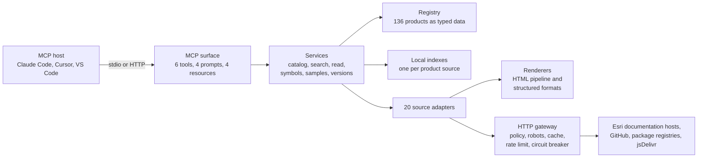

# arcgis-sdk-mcp

[](https://github.com/aselimc/arcgis-sdk-mcp/actions/workflows/ci.yml)
[](LICENSE)
[](package.json)

`arcgis-sdk-mcp` is a [Model Context Protocol](https://modelcontextprotocol.io) server that
lets a coding agent look things up in Esri's public ArcGIS developer documentation while it
works: guides, API references, REST specifications, samples, release notes and version facts
for 53 developer products, from the ArcGIS Maps SDK for JavaScript to ArcPy. It ships no
documentation. It fetches the page, index file or package file the agent asks for, turns it
into compact Markdown, and returns it with the product, the version and the source URL.

> **Unofficial. Not affiliated with, endorsed by or sponsored by Esri.** This is an
> independent open-source project. Pages are fetched from Esri's public sites when your agent
> asks for them, cached on your machine, and returned with a source line. Read
> [Source policy and legal note](#source-policy-and-legal-note) before you rely on it.

## Contents

- [Why](#why)
- [Quick start](#quick-start)
- [The six tools](#the-six-tools)
- [A typical agent workflow](#a-typical-agent-workflow)
- [Product coverage](#product-coverage)
- [Configuration](#configuration)
- [Command line](#command-line)
- [How it works](#how-it-works)
- [Source policy and legal note](#source-policy-and-legal-note)
- [Development and testing](#development-and-testing)
- [Status and known limitations](#status-and-known-limitations)
- [Roadmap](#roadmap)
- [Licence](#licence)

## Why

ArcGIS APIs change with every release. The JavaScript SDK moved from 4.x widgets to 5.x web
components, and the native SDKs moved from 200.x to 300.x, so what a model remembers is often
a version behind. This server lets the agent check instead of guess.

- **Version aware.** It reports the version the documentation describes, the version a
  package manager installs and the version found in your project, and says when they differ.
- **Small answers.** Every result has a token budget. A long page comes back as its opening
  section and an outline with section sizes; one more call reads the section that is needed.
- **One kind of handle.** A document reference is its URL. The agent can pass back any Esri
  documentation URL it meets in code, in an error message or in a search result.
- **Clear about gaps.** "Not found" is reported as "not verified", a degraded answer says
  why, and every result names its source and retrieval date.

## Quick start

Requires Node.js 22.12 or later. Nothing else needs to be installed or configured: there is
no API key and no account.

```sh
npx -y arcgis-sdk-mcp --version
npx -y arcgis-sdk-mcp call list_products
```

If npm answers that the package does not exist, the first release has not reached the npm
registry yet: use [From a clone](#from-a-clone) instead.

An MCP host starts the server itself. Add it to yours:

### Claude Code

```sh
claude mcp add arcgis-docs -- npx -y arcgis-sdk-mcp
```

On Windows (outside WSL) wrap the command: `claude mcp add arcgis-docs -- cmd /c npx -y arcgis-sdk-mcp`.
To share the entry with a team, put it in a `.mcp.json` file at the project root;
[.mcp.json.example](.mcp.json.example) has both forms (keep the one for your platform).

### Claude Desktop

Settings, Developer, Edit Config opens `claude_desktop_config.json`:

```json
{
  "mcpServers": {
    "arcgis-docs": {
      "command": "npx",
      "args": ["-y", "arcgis-sdk-mcp"]
    }
  }
}
```

### Cursor

`.cursor/mcp.json` in the project, or `~/.cursor/mcp.json` for every project:

```json
{
  "mcpServers": {
    "arcgis-docs": {
      "command": "npx",
      "args": ["-y", "arcgis-sdk-mcp"]
    }
  }
}
```

### VS Code

`.vscode/mcp.json` in the workspace (note the `servers` key):

```json
{
  "servers": {
    "arcgis-docs": {
      "type": "stdio",
      "command": "npx",
      "args": ["-y", "arcgis-sdk-mcp"]
    }
  }
}
```

### Windows

Some hosts on Windows cannot start the `npx` shim directly and report that the server failed
to start. Run it through `cmd` in any of the configurations above:

```json
{
  "command": "cmd",
  "args": ["/c", "npx", "-y", "arcgis-sdk-mcp"]
}
```

### Project detection

The server looks for Esri SDKs in the directory it is started in, so that a bare symbol name
or an unscoped search refers to the SDK your project uses. Hosts that start servers somewhere
else (Claude Desktop, a global Cursor entry) can name the project:

```json
{
  "command": "npx",
  "args": ["-y", "arcgis-sdk-mcp"],
  "env": { "ARCGIS_DOCS_PROJECT_DIR": "/path/to/your/project" }
}
```

### From a clone

```sh
git clone https://github.com/aselimc/arcgis-sdk-mcp.git
cd arcgis-sdk-mcp
npm ci
npm run build
node dist/cli/main.js --version
```

Point the host at the built file, with an absolute path:

```json
{
  "mcpServers": {
    "arcgis-docs": {
      "command": "node",
      "args": ["/absolute/path/to/arcgis-sdk-mcp/dist/cli/main.js"]
    }
  }
}
```

### HTTP

```sh
npx -y arcgis-sdk-mcp --http --port 3333
```

Serves stateless MCP at `http://127.0.0.1:3333/mcp`, with a health check at `/healthz`. It
binds to loopback and validates the `Host` and `Origin` headers. Any other `--host` needs
`--allow-remote`, and the server has no authentication. Project detection and local package
reads are off in HTTP mode. Operating a shared or public instance needs Esri's permission
(see [below](#source-policy-and-legal-note)).

## The six tools

All six are read-only. The server's instructions tell the agent in which order to use them,
so nothing has to be added to a prompt. Full argument and result schemas are in
[docs/tools.md](docs/tools.md).

| Tool                        | What it does                                                                                |
| --------------------------- | ------------------------------------------------------------------------------------------- |
| `arcgis_docs_list_products` | Lists products, describes one, or returns the table of contents of one documentation source |
| `arcgis_docs_get_versions`  | Documented, installable and project versions, compatibility pairings, release-notes refs    |
| `arcgis_docs_search`        | Ranked hits over guides, API members, REST operations, samples and product help             |
| `arcgis_docs_read`          | One page, API reference page, sample, GitHub file or brief as clean Markdown                |
| `arcgis_docs_lookup_symbol` | Declaration and documentation of one class, method, component, REST operation or tool       |
| `arcgis_docs_find_samples`  | Runnable samples from Esri's sample pages and Apache-2.0 sample repositories                |

Every text result has the same shape: a status line (resolved product, version, kind, cache
state), the body, at most one `Next:` line holding a complete follow-up call, and a `Source:`
line. `arcgis_docs_read` and `arcgis_docs_lookup_symbol` return text only; the other four
also return `structuredContent` that conforms to an output schema.

The examples below are real output of `arcgis-sdk-mcp call`, recorded on 2026-10-13 and
shortened. `[...]` marks where lines were removed, including every sentence of documentation
prose: this repository does not reproduce Esri's text.

### `arcgis_docs_list_products`

```sh
arcgis-sdk-mcp call list_products '{"category":"native"}'
```

```text
ArcGIS products | category: native | 5 of 5

## native
- dotnet-maps-sdk: ArcGIS Maps SDK for .NET, 300.x. Native mapping SDK for .NET apps on WPF, .NET MAUI and WinUI in C#: 2D/3D maps, offline data, routing, geocoding.
- flutter-maps-sdk: ArcGIS Maps SDK for Flutter, 300.x. Mapping SDK for cross-platform Flutter apps in Dart on Android and iOS: maps, scenes, offline data, routing.
- kotlin-maps-sdk: ArcGIS Maps SDK for Kotlin, 300.x. Native mapping SDK for Android apps in Kotlin with Jetpack Compose: 2D/3D maps, offline data, routing, geocoding.
[...]

Next: arcgis_docs_list_products({"product":"dotnet-maps-sdk"})
```

With `product` it returns the profile (packages, version lines, documentation sources,
start-here links, pitfalls); with `product` and `section` the table of contents of one
source. The product summaries are this project's own wording.

### `arcgis_docs_get_versions`

```sh
arcgis-sdk-mcp call get_versions '{"product":"js-maps-sdk"}'
```

```text
Versions as of 2026-10-13 | js-maps-sdk

## ArcGIS Maps SDK for JavaScript (js-maps-sdk), active
Documentation describes: 5.1, released 2026-06 (https://developers.arcgis.com/javascript/latest/)
Installable:
- @arcgis/core 5.1.27 on npm [latest] (https://registry.npmjs.org/-/package/@arcgis/core/dist-tags)
Pre-release:
- rc: 5.2.0-next.145
- next: 6.0.0-next.6
Install:
- npm install @arcgis/core
[...]
Compatibility:
- ArcGIS Enterprise: 12.2 (https://developers.arcgis.com/javascript/latest/version-matrix/)
- Calcite components: 5.1.* (https://developers.arcgis.com/javascript/latest/version-matrix/)
[...]
Release notes:
- 5.1: https://developers.arcgis.com/javascript/latest/release-notes/
[...]

Next: arcgis_docs_read({"ref":"https://developers.arcgis.com/javascript/latest/release-notes/"})
Source: Esri documentation at the refs above (retrieved 2026-10-13). [...]
```

With no arguments it reports every Esri SDK it detects in the project's manifests.

### `arcgis_docs_search`

```sh
arcgis-sdk-mcp call search '{"query":"FeatureLayer queryFeatures","product":"js-maps-sdk","limit":4}'
```

```text
Search "FeatureLayer queryFeatures" | products: js-maps-sdk, resolved from "js-maps-sdk" | line: latest | mode: local index (site search off) | hits 1-4 of 107
Note: More hits: arcgis_docs_search({"query":"FeatureLayer queryFeatures","product":"js-maps-sdk","cursor":"eyJ2Ijox[...]"})

1. queryFeatures() [api, method] js-maps-sdk/core 5.1
   https://developers.arcgis.com/javascript/latest/references/core/layers/FeatureLayer/#queryFeatures
   In: @arcgis/core/layers/FeatureLayer
   [...]
2. queryTopFeatures() [api, method] js-maps-sdk/core 5.1
   https://developers.arcgis.com/javascript/latest/references/core/layers/FeatureLayer/#queryTopFeatures
   In: @arcgis/core/layers/FeatureLayer
3. FeatureLayer [api] js-maps-sdk/core 5.1
   https://developers.arcgis.com/javascript/latest/references/core/layers/FeatureLayer/
   [...]

Next: arcgis_docs_read({"ref":"https://developers.arcgis.com/javascript/latest/references/core/layers/FeatureLayer/#queryFeatures"})
Source: Esri documentation at the refs above (retrieved 2026-10-13). [...]
```

Without `product` the search uses the SDKs detected in the project, or picks at most three
likely products and names them in the status line.

### `arcgis_docs_read`

```sh
arcgis-sdk-mcp call read '{"ref":"https://developers.arcgis.com/rest/services-reference/enterprise/query-feature-service-layer/","max_tokens":1500}'
```

```text
Query (Feature Service/Layer) | ArcGIS REST APIs (rest-api) | version 12.1 | api | cached

- **URL:** `https://<root>/<serviceName>/FeatureServer/<layerId>/query`
- **Methods:** `GET`, `POST`
[...]

Outline (pass an id as "section" to read that part):

- `query-feature-servicelayer` Query (Feature Service/Layer) (~23210 tokens)
  - `description` Description (~418 tokens)
  - `features-added-throughout-releases` Features added throughout releases (~2088 tokens)
  - `request-parameters` Request parameters (~14567 tokens)
  - `example-usage` Example usage (~1658 tokens)
  - `json-response-syntax` JSON Response syntax (~396 tokens)
  - `json-response-example` JSON Response example (~4075 tokens)

Next: arcgis_docs_read({"ref":"https://developers.arcgis.com/rest/services-reference/enterprise/query-feature-service-layer/","section":"request-parameters"})
Source: Esri, https://developers.arcgis.com/rest/services-reference/enterprise/query-feature-service-layer/ (retrieved 2026-10-13, cached). Copyright (c) Esri. Use subject to Esri's terms: https://www.esri.com/en-us/legal/overview
```

A 23,000-token page costs 1,500 tokens here, and the agent knows which section to ask for.
`view: "outline"` returns only the outline, `view: "full"` pages through the document with a
cursor, and `section: "source"` on a sample returns only its code.

### `arcgis_docs_lookup_symbol`

```sh
arcgis-sdk-mcp call lookup_symbol '{"symbol":"arcpy.da.SearchCursor","detail":"signature"}'
```

````text
arcpy.da.SearchCursor (class) | ArcPy and geoprocessing tools (arcpy), resolved from "arcpy.da.SearchCursor" | version 3.7 | api | cached

```python
SearchCursor(in_table, field_names, {where_clause}, {spatial_reference}, {explode_to_points}, {sql_clause}, {datum_transformation}, {spatial_filter}, {spatial_relationship}, {search_order})
```

# SearchCursor

[...]

Other matches:
- {"symbol":"arcpy.SearchCursor","product":"arcpy"} (function): https://doc.esri.com/en/arcgis-pro/latest/arcpy/functions/searchcursor.html

Next: arcgis_docs_lookup_symbol({"symbol":"arcpy.da.SearchCursor","product":"arcpy","detail":"summary"})
Source: Esri, https://doc.esri.com/en/arcgis-pro/latest/arcpy/data-access/searchcursor-class.html (retrieved 2026-10-13, cached). [...]
````

The product was resolved from the qualified name. `detail: "summary"` (the default) adds the
description, parameters, return value and one example, or the member index of a type;
`"full"` returns everything within `max_tokens`. An ambiguous name lists the candidates as
copyable calls, and a name that is not found lists the nearest names with the reminder that
this does not prove the symbol does not exist.

### `arcgis_docs_find_samples`

```sh
arcgis-sdk-mcp call find_samples '{"query":"download offline map","product":"swift-maps-sdk","limit":3}'
```

```text
Samples for "download offline map" | product: swift-maps-sdk | line: latest | pinned to 300.1.0 | 3 of 74

1. Download preplanned map area [swift-maps-sdk, swift, github, apache-2.0]
   https://github.com/Esri/arcgis-maps-sdk-swift-samples/blob/v300.1.0/Shared/Samples/Download%20preplanned%20map%20area/README.md
   Take a map offline using a preplanned map area.
   In: Edit and Manage Data
   APIs: DownloadPreplannedOfflineMapResult, OfflineMapTask, [...], PreplannedMapArea
   File: DownloadPreplannedMapAreaView.swift https://github.com/Esri/arcgis-maps-sdk-swift-samples/blob/v300.1.0/Shared/Samples/Download%20preplanned%20map%20area/DownloadPreplannedMapAreaView.swift
   [...]
2. Generate offline map with local basemap [swift-maps-sdk, swift, github, apache-2.0]
   [...]
3. Generate offline map [swift-maps-sdk, swift, github, apache-2.0]
   [...]

Next: arcgis_docs_read({"ref":"https://github.com/Esri/arcgis-maps-sdk-swift-samples/blob/v300.1.0/Shared/Samples/Download%20preplanned%20map%20area/README.md","section":"source"})
Source: Esri documentation at the refs above (retrieved 2026-10-13). [...]
```

GitHub samples are pinned to a release tag where the repository's tags are reliable.
`uses_api` finds samples that use a given class or method, `platform` narrows a
multi-platform SDK (`maui`, `wpf`, `winui`), and `with_code: true` also returns the main
source file of the best hit.

### Errors

A failed call says what went wrong and what to do next, in one line:

```text
Error [LINK_ONLY]: https://archive.developers.arcgis.com/javascript/v4-34/ is not fetched by this server. archive.developers.arcgis.com excludes automated access. Next: Open https://archive.developers.arcgis.com/javascript/v4-34/ in a browser, or search the current documentation with arcgis_docs_search({"query":"v4 34"}).
```

### Prompts and resources

Four prompts script common jobs for hosts that show prompts: `arcgis_app_kickoff` (plan a new
app), `arcgis_upgrade_review` (review an SDK upgrade), `arcgis_agentic_app_design` (design an
app that uses Esri's AI components or MCP servers) and `arcgis_project_instructions` (write
`AGENTS.md`-style instructions for a project).

Four resources are available under `arcgis-docs://`: `catalog` (every product as JSON),
`product/{id}` (one profile), `brief/{slug}` (ten short briefs written by this project, also
readable as `brief:<slug>` through `arcgis_docs_read`) and `status` (the effective source
policy, the cache, detected SDKs and the health of each source).

## A typical agent workflow

A user asks an agent to add clustering with popups to a web map. The project's
`package.json` lists `@arcgis/core`.

1. `arcgis_docs_get_versions({})` finds `@arcgis/core` in the project, reports the installed
   version next to the current one, and returns the refs of the release notes.
2. `arcgis_docs_lookup_symbol({"symbol":"FeatureLayer.featureReduction"})` returns the
   declaration and documentation of the property. No `product` is needed: one SDK was
   detected.
3. `arcgis_docs_search({"query":"cluster points with popups"})` finds the guide page, and
   `arcgis_docs_read({"ref":"<url>","section":"<id>"})` reads only the section the outline
   pointed to.
4. `arcgis_docs_find_samples({"query":"point clustering","uses_api":"FeatureLayer"})` returns
   a runnable sample; `arcgis_docs_read` with `section: "source"` returns its code.
5. The agent writes the change and cites the source URLs it relied on.

Most results end with a `Next:` line holding the most useful follow-up call, so the agent
rarely has to work out the next step itself.

## Product coverage

The registry holds 136 entries: the 53 developer products below, 7 tombstones for deprecated
and retired developer products (ArcGIS Runtime 100.x, ArcObjects, the JavaScript API 3.x and
others, most of them pointing to a successor), and 76 end-user help products (ArcGIS Online,
ArcGIS Enterprise, ArcGIS Pro, Survey123 and so on) under the category `product-help`.
[docs/products.md](docs/products.md) lists all of them, the developer products with their
version lines and documentation sources.

The table is generated from the registry. "Symbols" means `arcgis_docs_lookup_symbol` has an
API or specification source to resolve names against, "Samples" that
`arcgis_docs_find_samples` has a sample source, and "Release notes" that
`arcgis_docs_get_versions` returns release-notes refs. Every product can be searched and
read.

| Product id                    | Product                                            | Category                             | Current line | Symbols | Samples | Release notes |
| ----------------------------- | -------------------------------------------------- | ------------------------------------ | ------------ | ------- | ------- | ------------- |
| `js-maps-sdk`                 | ArcGIS Maps SDK for JavaScript                     | Web                                  | 5.x          | yes     | yes     | yes           |
| `calcite`                     | Calcite Design System                              | Web                                  | Current      | yes     |         | yes           |
| `arcade`                      | ArcGIS Arcade                                      | Web                                  | Current      | yes     | yes     | yes           |
| `rest-js`                     | ArcGIS REST JS                                     | Web                                  | Current      | yes     | yes     | yes           |
| `experience-builder`          | ArcGIS Experience Builder (developer edition)      | Web                                  | Current      | yes     | yes     | yes           |
| `esri-leaflet`                | Esri Leaflet                                       | Web                                  | Current      | yes     |         |               |
| `maplibre-arcgis`             | MapLibre GL JS with ArcGIS                         | Web                                  | Current      | yes     |         | yes           |
| `openlayers-arcgis`           | OpenLayers with ArcGIS                             | Web                                  | Current      |         |         |               |
| `cesium-arcgis`               | CesiumJS with ArcGIS                               | Web                                  | Current      |         |         |               |
| `web-map-spec`                | Web map specification                              | Web                                  | Current      | yes     |         |               |
| `web-scene-spec`              | Web scene specification                            | Web                                  | Current      | yes     |         |               |
| `swift-maps-sdk`              | ArcGIS Maps SDK for Swift                          | Native                               | 300.x        | yes     | yes     | yes           |
| `kotlin-maps-sdk`             | ArcGIS Maps SDK for Kotlin                         | Native                               | 300.x        | yes     | yes     | yes           |
| `dotnet-maps-sdk`             | ArcGIS Maps SDK for .NET                           | Native                               | 300.x        | yes     | yes     | yes           |
| `qt-maps-sdk`                 | ArcGIS Maps SDK for Qt                             | Native                               | 300.x        | yes     | yes     | yes           |
| `flutter-maps-sdk`            | ArcGIS Maps SDK for Flutter                        | Native                               | 300.x        | yes     | yes     | yes           |
| `unity-maps-sdk`              | ArcGIS Maps SDK for Unity                          | Game engines                         | 2.x          | yes     | yes     | yes           |
| `unreal-maps-sdk`             | ArcGIS Maps SDK for Unreal Engine                  | Game engines                         | 2.x          | yes     | yes     | yes           |
| `python-api`                  | ArcGIS API for Python                              | Python, data science and R           | 2.4.x        | yes     | yes     | yes           |
| `arcpy`                       | ArcPy and geoprocessing tools                      | Python, data science and R           | Pro 3.7      | yes     |         | yes           |
| `geoanalytics-engine`         | ArcGIS GeoAnalytics Engine                         | Python, data science and R           | Current      | yes     | yes     | yes           |
| `geoanalytics-fabric`         | ArcGIS GeoAnalytics for Microsoft Fabric           | Python, data science and R           | Current      | yes     | yes     | yes           |
| `r-arcgis`                    | R-ArcGIS Bridge and arcgis R packages              | Python, data science and R           | Current      | yes     |         | yes           |
| `arcgis-pro-sdk`              | ArcGIS Pro SDK for .NET                            | Desktop and Enterprise extensibility | Pro 3.x      | yes     | yes     |               |
| `enterprise-sdk`              | ArcGIS Enterprise SDK                              | Desktop and Enterprise extensibility | Current      | yes     | yes     | yes           |
| `cityengine`                  | ArcGIS CityEngine                                  | Desktop and Enterprise extensibility | Current      | yes     | yes     | yes           |
| `earth-automation-api`        | ArcGIS Earth Automation API                        | Desktop and Enterprise extensibility | Current      | yes     |         |               |
| `autocad-api`                 | ArcGIS for AutoCAD API                             | Desktop and Enterprise extensibility | Current      | yes     |         |               |
| `rest-api`                    | ArcGIS REST APIs                                   | REST APIs, services and platform     | Current      | yes     |         | yes           |
| `developer-guide`             | ArcGIS developer guide                             | REST APIs, services and platform     | Current      |         |         |               |
| `location-platform`           | ArcGIS Location Platform help                      | REST APIs, services and platform     | Current      |         |         | yes           |
| `hub-dev`                     | ArcGIS Hub developer APIs                          | REST APIs, services and platform     | Current      | yes     |         |               |
| `site-scan-api`               | Site Scan for ArcGIS API                           | REST APIs, services and platform     | Current      | yes     |         |               |
| `urban-api`                   | ArcGIS Urban API                                   | REST APIs, services and platform     | Current      |         | yes     | yes           |
| `workflow-manager-dev`        | ArcGIS Workflow Manager developer APIs             | REST APIs, services and platform     | Current      | yes     | yes     | yes           |
| `survey123-dev`               | ArcGIS Survey123 developer resources               | REST APIs, services and platform     | Current      | yes     | yes     |               |
| `velocity-grpc`               | ArcGIS Velocity gRPC feeds (beta)                  | REST APIs, services and platform     | Current      | yes     |         |               |
| `ai-agents`                   | AI, agents and MCP across ArcGIS (beta)            | AI                                   | Current      |         |         | yes           |
| `i3s-spec`                    | Indexed 3D Scene Layer (I3S) specification         | Specifications and formats           | Current      | yes     |         |               |
| `cim-spec`                    | Cartographic Information Model (CIM) specification | Specifications and formats           | Current      | yes     |         |               |
| `arcgis-pbf`                  | ArcGIS feature service protocol buffers (PBF)      | Specifications and formats           | Current      | yes     |         |               |
| `knowledge-pbf`               | ArcGIS Knowledge protocol buffers                  | Specifications and formats           | Current      | yes     |         |               |
| `lerc`                        | LERC (Limited Error Raster Compression)            | Specifications and formats           | Current      | yes     |         |               |
| `tile-package-spec`           | Tile package specification (TPKX)                  | Specifications and formats           | Current      | yes     |         |               |
| `spatially-optimized-parquet` | Spatially optimized Parquet                        | Specifications and formats           | Current      | yes     |         |               |
| `3d-tiles-esri-crs`           | 3D Tiles layer with Esri coordinate systems        | Specifications and formats           | Current      | yes     |         |               |
| `projection-engine-db`        | Projection engine database documentation           | Specifications and formats           | Current      | yes     |         |               |
| `file-geodatabase-api`        | File Geodatabase API                               | Specifications and formats           | Current      | yes     |         |               |
| `enterprise-devops`           | ArcGIS Enterprise deployment automation            | DevOps and open source               | Current      |         |         |               |
| `koop`                        | Koop                                               | DevOps and open source               | Current      |         |         |               |
| `developer-support`           | Esri developer support samples                     | DevOps and open source               | Current      |         | yes     |               |
| `oss-libraries`               | Esri open-source libraries                         | DevOps and open source               | Current      |         | yes     |               |
| `support-kb`                  | Esri Support knowledge base                        | Support                              | Current      |         |         |               |

## Configuration

Everything is set through environment variables, in the `env` object of the host's server
entry or in the shell. None is required.

| Variable                   | Default                  | Meaning                                                                                                              |
| -------------------------- | ------------------------ | -------------------------------------------------------------------------------------------------------------------- |
| `ARCGIS_DOCS_SOURCES`      | `standard`               | Source policy: a preset (`strict` or `standard`) and/or `+capability` / `-capability` items, comma separated         |
| `ARCGIS_DOCS_OFFLINE`      | off                      | `1` answers from the cache only; a document that is not cached fails with `OFFLINE_MISS`                             |
| `ARCGIS_DOCS_CACHE_DIR`    | per-user cache directory | Where responses and indexes are stored                                                                               |
| `ARCGIS_DOCS_CACHE_MAX_MB` | `500`                    | Size cap of the cache on disk                                                                                        |
| `ARCGIS_DOCS_PROJECT_DIR`  | working directory        | The project in which Esri SDK versions are detected                                                                  |
| `ARCGIS_DOCS_MAX_TOKENS`   | `6000`                   | Size of an `arcgis_docs_read` result when the call does not choose `max_tokens` (500 to 20000)                       |
| `ARCGIS_DOCS_LOG_LEVEL`    | `warn`                   | `debug`, `info`, `warn`, `error` or `silent`. Logs are JSON lines on stderr; stdout carries only the protocol        |
| `GITHUB_TOKEN`             | none                     | Raises the GitHub API quota from 60 to 5,000 requests per hour. No scopes are needed; it is sent to `api.github.com` |

An invalid value stops the server at start-up with a message that names the variable. The
list of tools never changes with the configuration. Details, including the cache, proxies
and HTTP mode, are in [docs/configuration.md](docs/configuration.md).

## Command line

The binary is also a small toolbox for people. `call` prints exactly the text an agent would
receive, which makes it the quickest way to try a query or to report a problem.

```text
arcgis-sdk-mcp                          Serve MCP over stdio (what an MCP host runs)
arcgis-sdk-mcp --http [--port 3333] [--host 127.0.0.1]
arcgis-sdk-mcp doctor [--product <id>] [--tier developer|all] [--json]
arcgis-sdk-mcp cache info
arcgis-sdk-mcp cache clear [http|derived|all]
arcgis-sdk-mcp warm <product...>        Build the search indexes of the given products
arcgis-sdk-mcp call <tool> ['<json>']   Run one tool and print its text result
arcgis-sdk-mcp --version | --help
```

`call` accepts the short tool name (`search`, `lookup_symbol` or `lookup-symbol`). The
examples in this README quote JSON for a POSIX shell and PowerShell 7.3 or later; in
`cmd.exe` use `"{\"query\":\"cluster points\"}"`.

`doctor` checks the configuration, the cache directory, proxy variables and the GitHub
quota, then probes the documentation sources through the normal gateway:

```text
[ok]   config: arcgis-sdk-mcp 0.1.0, Node 22.15.0, stdio mode
[ok]   policy: preset standard
       enabled: github, registries, local-packages, workspace, website, site-index, package-cdn
       disabled: site-search, lifecycle-api
[ok]   proxy: no proxy variables are set
[ok]   adapters: 20 source adapters, 136 products
[warn] github: unauthenticated (60 requests per hour), quota not read yet
[...]
Sources probed: 2 ok, 0 failed, 0 skipped
[ok]   calcite/guide (gatsby, floor, 180 records, 27590 chars, 6 ms)
[ok]   calcite/components (npm-cem, 4 records, 85 chars, 6 ms)

Result: ok
```

## How it works



- **Registry.** Every product is typed data: ids, aliases, version lines and a list of
  sources, each naming an adapter and its configuration. Every product has one _floor
  source_, a simple one (a sitemap, a static list, a repository) that keeps it reachable when
  a richer source breaks. The registry holds URLs and patterns, never Esri's prose.
- **Adapters.** One per way documentation is published: Astro and Gatsby sites, DocFX,
  legacy help, DocC, Dokka, dartdoc, javadoc, Sphinx, OpenAPI documents, TypeScript
  declarations, Custom Elements Manifests, GitHub repositories and more. An adapter lists a
  source into catalogue records and reads one document.
- **Renderers.** Structured sources (OpenAPI, TypeDoc, DocC JSON, Custom Elements Manifests,
  Sphinx inventories, C# XML documentation, TypeScript declarations) are rendered directly.
  HTML pages go through a pipeline that detects the page family (16 of them), slices out the
  requested section before cleaning, and converts to Markdown with language-tagged fences and
  absolute links.
- **Local search.** The first search of a source builds an index from the site's own
  sitemap or index file and stores it on disk. A side table answers exact symbol names. No
  page bodies are crawled; the text of pages the agent has already read is added to the index.
- **One gateway.** Every outbound request passes through one module that applies the host
  allow-list, the capability policy, robots rules, the disk cache with conditional
  revalidation, per-host rate limits, retries and a circuit breaker. Redirects are followed
  manually and each hop is checked again.
- **Degradation ladders.** When a source fails, a simpler one answers (index file, then
  sitemap, then the previous snapshot, then the registry's entry links), and the result says
  which rung it came from. A rebuilt index never replaces a much larger good one.

[docs/architecture.md](docs/architecture.md) describes the layers, the request flow and the
import rules; the decisions behind them are recorded as [ADRs](docs/adr).

## Source policy and legal note

**What the server does**

- **On demand only.** A request to an upstream host happens only because your agent called a
  tool or you ran a CLI command. Nothing is fetched at start-up, nothing is crawled, and
  there is no scheduled refresh and no telemetry.
- **Per-user cache.** Responses are cached on your machine to avoid repeated requests. The
  cache is not shared and not redistributed. `arcgis-sdk-mcp cache clear` deletes it.
- **Attribution.** Every result ends with a source line that names the URL, the retrieval
  date and the rights holder, worded for the licence of the content (Esri's website terms,
  Apache-2.0 for Esri's GitHub repositories, the Esri Master License Agreement for files of
  Esri npm packages).
- **Nothing Esri-authored is shipped.** The repository and the npm package contain code, the
  registry (ids, URLs, patterns) and ten briefs written by this project. A release gate fails
  the build if the tarball holds anything else. Test fixtures are synthetic or Apache-2.0.
- **A considerate client.** One identifying User-Agent with this repository's URL,
  `robots.txt` honoured (compiled rules plus a daily live check that can only add
  restrictions), at most two requests per second per host, an allow-list of hosts, and
  `403` and `429` responses treated as final. Hosts that exclude automated access, such as
  Esri's archive of older documentation, are link-only: the server returns the URL and never
  fetches it.

**What you can switch off**

`ARCGIS_DOCS_SOURCES` selects a preset and switches individual capabilities:

| Capability       | `strict` | `standard` | Covers                                                                               |
| ---------------- | -------- | ---------- | ------------------------------------------------------------------------------------ |
| `github`         | on       | on         | Public repositories of Esri, R-ArcGIS and koopjs through the GitHub API              |
| `registries`     | on       | on         | Version metadata from npm, PyPI, NuGet and pub.dev, and the ArcGIS Online version    |
| `local-packages` | on       | on         | Esri packages already installed in your project's `node_modules` (stdio mode)        |
| `workspace`      | on       | on         | Names and versions in your project's package manifests (stdio mode)                  |
| `website`        | off      | on         | Pages on Esri's documentation hosts and published OpenAPI documents                  |
| `site-index`     | off      | on         | Sitemaps, navigation files and the sites' own search and symbol index files          |
| `package-cdn`    | off      | on         | Single files of Esri npm packages at a pinned version from jsDelivr                  |
| `site-search`    | off      | off        | Esri's site search service; adds full-text hits to `arcgis_docs_search` (opt-in)     |
| `lifecycle-api`  | off      | off        | Esri's product life-cycle service; adds dates to `arcgis_docs_get_versions` (opt-in) |

```sh
ARCGIS_DOCS_SOURCES=strict               # GitHub, package registries and your own project only
ARCGIS_DOCS_SOURCES=-package-cdn         # standard without jsDelivr
ARCGIS_DOCS_SOURCES=strict,+website      # strict plus page fetches
ARCGIS_DOCS_SOURCES=standard,+site-search
ARCGIS_DOCS_OFFLINE=1                    # no requests at all; cached content only
```

A tool that needs a capability that is off either degrades and says so, or answers
`SOURCE_DISABLED` naming the value that would enable it.

**Please read this before relying on it.** Esri's website terms restrict automated access
and the use of its content with AI tools, and can be read to cover a documentation retrieval
tool such as this one. The default preset also reads two kinds of files a cautious reading
would leave off: index files the sites publish for their own search and navigation, and
files of Esri npm packages (licensed under the Esri Master License Agreement) from a public
CDN. This project's position is that on-demand, attributed, per-user retrieval of public
documentation is reasonable. That is not legal advice, and it is not Esri's permission. You
decide whether your use is acceptable under
[Esri's terms](https://www.esri.com/en-us/legal/overview). Do not operate a public, shared or
paid instance without Esri's permission. If Esri asks for a source to be removed or a default
to change, it will be.

The reasoning is recorded in [docs/source-policy.md](docs/source-policy.md) and
[ADR-0002](docs/adr/0002-site-index-and-package-cdn-defaults.md).

## Development and testing

```sh
npm ci
npm run typecheck
npm run lint
npm test                 # unit project; no network
npm run build
node dist/cli/main.js doctor --product js-maps-sdk
```

- `npm test` never touches the network: a guard replaces `fetch` and rejects every request
  that is not to loopback. Adapters are tested against synthetic recordings through a shared
  contract suite, HTML extraction and renderers against hand-written fixtures with exact
  expected Markdown, and the gateway and services against injected faults.
- `npm run test:e2e` builds, packs the tarball, installs it in a temporary directory and
  drives the packed binary over stdio and HTTP.
- `npm run test:live` checks invariants on real pages recorded to a git-ignored directory.
  A weekly canary workflow runs it together with `doctor` and opens an issue when a
  documentation site has changed.
- `evals/` holds 25 agent tasks and a runner that needs a model API key; see
  [evals/README.md](evals/README.md).

[CONTRIBUTING.md](CONTRIBUTING.md) has the working rules, [docs/testing.md](docs/testing.md)
the test layers and the fixture policy, and [docs/adding-a-product.md](docs/adding-a-product.md)
and [docs/adding-an-adapter.md](docs/adding-an-adapter.md) the two most common changes.
Security reports: [SECURITY.md](SECURITY.md).

## Status and known limitations

Version 0.1.0 is the first version. All six tools were exercised against the live sites on
2026-10-13, and `doctor` reached all 58 sources of the developer products. The agent
evaluations have not been run yet, so there is no measured answer quality to report.

- **Search is local.** It matches titles, headings, keywords, descriptions and symbol names,
  plus the text of pages already read. A phrase that occurs only in the body of an unread
  page is not found. Exact API names rank well; natural-language questions rank less well,
  and a multi-word query that matches too little falls back to matching any word, which
  inflates the hit count.
- **Older versions.** The documentation sites describe the current release. For another
  version of the JavaScript SDK the server reads the TypeScript declarations of that npm
  version; Esri's archive of older pages is link-only.
- **Inherited members.** A member is followed to the base type that declares it, across at
  most four base pages. Swift members that come from a protocol extension are not followed.
- **Budgets cut at block boundaries.** A list, a table or a code fence is never split, so a
  result can end with budget left over when the next block is large. This is most visible on
  type summaries of the Flutter and Kotlin references.
- **.NET overloads.** A lookup that names one overload returns that overload only.
- **REST operation names** are derived from page titles (`Export Map` gives `exportMap`),
  not from the path segment (`export`).
- **Arcade.** Function documentation comes from the `@arcgis/coding-components` package,
  which can describe an earlier Arcade version than the one `arcgis_docs_get_versions`
  reports from the Arcade site.
- **Unity.** A class without a page in the published API reference is reported as not found.
- **GitHub quota.** Unauthenticated access allows 60 API requests per hour, which sample
  lookups on a cold cache use up quickly. Set `GITHUB_TOKEN`.
- **Sites change.** When a layout or an index file moves, results degrade to a simpler
  source and say so. `arcgis-sdk-mcp doctor` shows what is affected.

## Roadmap

Before 1.0:

- Run the agent evaluations and tune descriptions, ranking and budgets against them, with
  and without `+site-search`.
- Ask Esri whether this use of its documentation is acceptable, and adjust the defaults to
  the answer.
- Close the gaps listed above: natural-language ranking, overload listings, REST operation
  names from path segments, Swift protocol-extension members.
- Run the MCP Inspector strict check in CI.

Deliberately left out of the first version; each is one adapter or provider plus one
capability:

- Esri Community and the ArcGIS Blog.
- The documentation of Esri's Enterprise MCP server while it is in its early-adopter sandbox.
- Python API documentation archives and package archives of NuGet, PyPI and pub.dev read
  through HTTP range requests.
- ArcGIS Urban API GraphQL introspection, and coordinate-system (WKID) lookup.
- Geoprocessing error-code lookup, and export lists of the R packages.
- Inherited members in the TypeScript declaration scanner.
- A proxy dispatcher (today `NODE_USE_ENV_PROXY=1` with Node's built-in support) and a
  user-supplied registry overlay.
- Packaging: an `.mcpb` bundle and a Docker image.

## Licence

Apache-2.0 for this project's code; see [LICENSE](LICENSE) and [NOTICE](NOTICE). Esri, ArcGIS
and related names are trademarks of Esri, used here only to identify the products whose
public documentation the software retrieves. Documentation returned by the server remains
the property of Esri or its respective authors.
