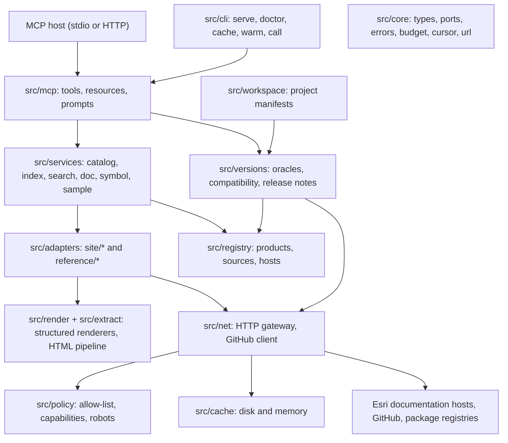
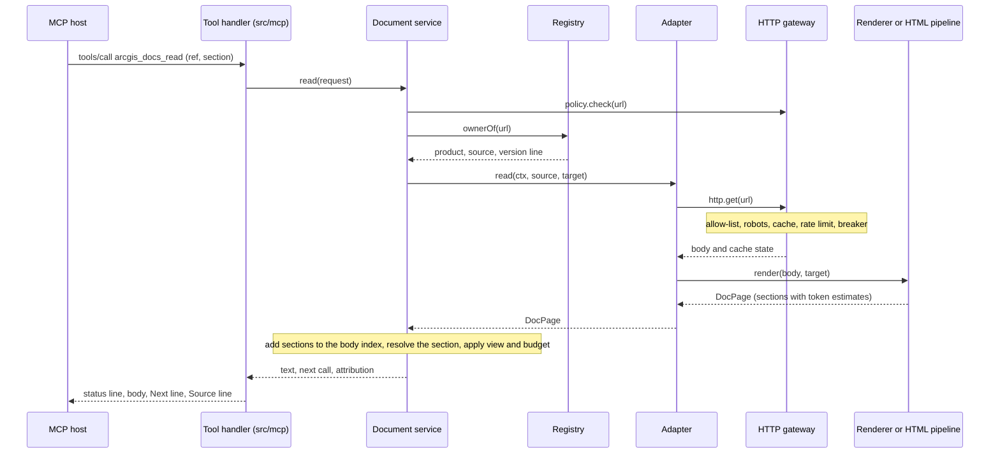

# Architecture

`arcgis-sdk-mcp` is a ports-and-adapters application. A small core defines the data types and
the interfaces between packages; every other package implements one of those interfaces and
knows nothing about the others. One composition root wires them together.

## Layers



Every box depends on `src/core`; the arrows show who calls whom at run time.

| Directory       | Responsibility                                                                                                                                                               |
| --------------- | ---------------------------------------------------------------------------------------------------------------------------------------------------------------------------- |
| `src/core`      | Domain types, the interfaces between packages (`ports.ts`), factory signatures, errors, token budget, cursors, URL helpers. Pure: no I/O                                     |
| `src/registry`  | The product registry as typed data: ids, aliases, sources, version lines, hosts. Resolution of free-text product names and of URLs to their owning source                    |
| `src/policy`    | Which hosts and paths may be requested under the current capabilities; robots rules                                                                                          |
| `src/net`       | The HTTP gateway (the only code that calls `fetch`) and the GitHub client                                                                                                    |
| `src/cache`     | Disk cache for responses and derived data, memory LRU for loaded indexes                                                                                                     |
| `src/extract`   | HTML to Markdown: family detection, slicing, clean-up passes, Turndown                                                                                                       |
| `src/render`    | Structured renderers: OpenAPI, TypeDoc, Custom Elements Manifest, DocC, Sphinx, C# XML documentation, TypeScript declarations, Arcade, Markdown, notebooks, sample bundles   |
| `src/adapters`  | One adapter per kind of source. `enumerate` lists a source into catalogue records, `read` returns one document, `symbol` and `sample` return one entity, `probe` is a canary |
| `src/services`  | The six use cases behind the tools, plus the index service that builds and persists per-source search indexes                                                                |
| `src/versions`  | Version oracles and the version report                                                                                                                                       |
| `src/workspace` | Detection of Esri SDK versions in the user's project (manifests only)                                                                                                        |
| `src/mcp`       | Tool, resource and prompt registration; envelopes and error rendering                                                                                                        |
| `src/cli`       | The binary: argument parsing and the commands                                                                                                                                |
| `src/app`       | The composition root                                                                                                                                                         |

## Import rules

ESLint (`eslint.config.mjs`, `no-restricted-imports` per directory) enforces:

1. `src/core` imports nothing outside `src/core` except `zod`.
2. Every other package imports only from `src/core` and from itself. Cross-package calls go
   through the `Ctx` object or a service interface.
3. Only `src/app/composition-root.ts` imports the concrete factories.
4. Adapters and services never call `fetch`, `fs` or `process.env`; they use `ctx.http`,
   `ctx.cache` and `ctx.config`.
5. Named exports only.

The effect is that an adapter can be written and tested against fakes
(`test/support`) without any other package existing.

## Request flow

```
tool handler  ->  service
  search:  registry.resolve | route -> index.ensure(product, sources, line) -> index.query -> rank -> presenter
  read:    splitRef -> policy.check -> registry.ownerOf(url) -> adapter.read -> view + budget -> presenter
  lookup:  resolve product -> index.ensure(symbol sources) -> exact / prefix / fuzzy -> adapter.symbol -> presenter
  samples: resolve product -> index.samples -> rank -> adapter.sample (metadata, code) -> presenter
```

A tool call owns a request budget (12 upstream requests, 25 seconds). Index builds have their
own budget (30 requests, 20 seconds) and continue in the background when a call's deadline
passes; the response then says which source was not searched yet. Nothing is fetched before
the MCP handshake, and nothing is fetched except as a consequence of a tool call or a CLI
command.

One `arcgis_docs_read` call, as an example of how the layers meet:



A URL on an allow-listed host that no source owns is read by the generic extractor. A
`brief:<slug>` ref is answered from the briefs bundled with the package, without a request.

## The HTTP gateway

`src/net/http-client.ts` is the single choke point for outbound traffic:

```
policy.check(url)        allow-list, capability, compiled robots rules, live robots.txt (24 h, adds denials only)
 -> offline?             cache only
 -> single-flight        one request per (method, URL, expected shape, body); a joiner whose
                         flight ended for the starter's own budget or cancellation asks again
 -> cache                fresh entry answers; entries are kept per expected shape
 -> pause                the host asked for a pause (Retry-After, spent quota): UPSTREAM_BLOCKED, no request
 -> budget, breaker      over budget or open breaker: stale copy or UPSTREAM_UNAVAILABLE (details.declined)
 -> rate limiter         token bucket and semaphore per host, global concurrency cap
 -> fetch                manual redirects; every hop is checked against the policy again
 -> validate             content type and shape; HTML where JSON was expected is a miss
 -> meta-refresh         followed like a redirect, with a loop guard
 -> store                size cap enforced while streaming
```

Failures map to a small error catalogue (`src/core/errors.ts`): `DOC_NOT_FOUND`,
`UPSTREAM_BLOCKED` (403 and 429 are never retried or worked around), `UPSTREAM_UNAVAILABLE`,
`OFFLINE_MISS` and so on. A request this server gave up on itself (spent budget, host pacing
beyond the deadline, a cancelled call) is `UPSTREAM_UNAVAILABLE` with `details.declined`, so
an enumeration never mistakes it for a missing file. The table on `HttpClient.get` in
`src/core/ports.ts` lists every outcome. A stale cached copy younger than 30 days is served, labelled
`stale`, when the upstream fails.

## Registry model

```
Product -> sources[] -> { adapter, config, capability, probe, floor }
        -> lines[]      version lines ("latest", "v200")
        -> oracles[]    where its version facts come from
```

Every product has exactly one **floor source**: a simple source (a sitemap, a static list, a
GitHub repository) that keeps the product reachable when a richer source breaks. The registry
is data only: ids, URLs, patterns and adapter configuration. Hashed file names are never
stored; adapters discover them at run time.

## Degradation ladders

Each capability has rungs, and a result says which rung answered when it is not the first.

| Capability         | Rung 1                             | Rung 2                            | Rung 3                              | Last resort                          |
| ------------------ | ---------------------------------- | --------------------------------- | ----------------------------------- | ------------------------------------ |
| Enumerate a source | native index file                  | sitemap or navigation of one page | previous snapshot                   | registry start-here links            |
| Search             | catalogue, symbol and body indexes | plus site search when enabled     | stale snapshot                      | product card with entry links        |
| Content            | structured renderer                | HTML family profile               | generic extractor                   | stale rendering, else a link         |
| Version            | package registry                   | page banner or sitemap            | static registry value with its date | "unknown" plus the release-notes ref |

A rebuilt index replaces the previous one only when it is not much smaller (the swap rule),
so a broken upstream index cannot replace a good local one.

## Search

One catalogue index per `(product, source, line)`, built on first use from the adapter's
`enumerate()` and persisted as a compressed snapshot. MiniSearch ranks over symbol, title,
qualified name, headings, keywords, description and breadcrumb. A symbol side table answers
exact-name lookups. Pages the agent has already read contribute their section text to a
per-product body index. There is no full-text crawl; see the limitations in the README.

## Output

Every text result has the same envelope: a status line (resolved product, version, kind,
cache state), the body, at most one `Next:` line with a complete follow-up call, and a
`Source:` line whose wording depends on the licence tier of the content. Text is cut only at
section, paragraph, fence, list or table boundaries, and a cut always leaves a `Next:` line
with the call that continues. `read` and `lookup_symbol` return text only; the other four
tools also return `structuredContent` that conforms to their `outputSchema`.

Two consequences of cutting at block boundaries are worth knowing. A result can end with
budget left over when the next block (a long member list, a large table) does not fit. And
the summary of a type reserves part of its budget for a names-only member index, so that a
long class description cannot push the member list out of the answer; this applies where the
source reports members (JavaScript, Python, web components, ArcGIS Pro SDK).

## Where the implementation differs from the first design

- A table of contents (`arcgis_docs_list_products` with `section`) is paged by the call's
  `limit` (default 80), not by a fixed 100 entries.
- `ARCGIS_DOCS_MAX_TOKENS` cannot change the default in the tool schema, because the schema
  is the same in every configuration. A `read` call that carries the schema default (6000) is
  treated as not having chosen a size.
- The HTML pipeline has one more shared pass than first planned: it opens `<details>`
  blocks, so that their content joins the page and a bare "Read more" toggle label does not
  end up as a stray line.
- A robots denial is reported with the code `LINK_ONLY`: the error catalogue has no separate
  code for it, and the recovery (open the URL yourself) is the same.

## Decisions

The reasons behind the main choices are recorded as ADRs in [docs/adr](adr):

| ADR                                                     | Decision                                                 |
| ------------------------------------------------------- | -------------------------------------------------------- |
| [0001](adr/0001-mcp-sdk-v2.md)                          | Build on the MCP TypeScript SDK v2                       |
| [0002](adr/0002-site-index-and-package-cdn-defaults.md) | Site index files and package CDN reads are on by default |
| [0003](adr/0003-no-shipped-esri-content.md)             | Ship no Esri-authored content                            |
| [0004](adr/0004-six-tools-url-refs.md)                  | Six tools, and a reference is a URL                      |
| [0005](adr/0005-structured-over-scraping.md)            | Prefer structured sources to HTML scraping               |
| [0006](adr/0006-fixture-policy.md)                      | Fixtures are synthetic, open source, or uncommitted      |
| [0007](adr/0007-tsc-build.md)                           | Build with tsc                                           |

[products.md](products.md) lists what the registry covers.
